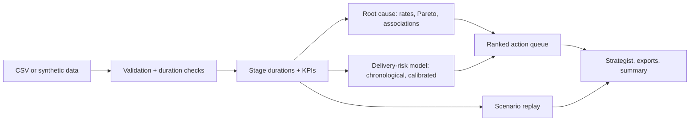

# DELIVR AI — Delivery Performance & Operations Intelligence
Find the delay. Fix the process.

Diagnoses rising delivery delays across the order journey (release, picking, dispatch, transit), predicts which open orders will miss their promise, and ranks evidence-based operational actions. Bundled data is **fictional synthetic data** with planted patterns (warehouse backlog, stock holds, carrier-zone variability).

## Architecture


## Run
```
pip install -r requirements.txt
python app.py
```
In Google Colab paste `app.py` into one cell. The `src/` modules in the brief are consolidated into `app.py`.

## Tests and limits
`pip install pytest && pytest tests` runs the built-in self-tests. See `docs/`. Not included: OR-Tools routing demo, PDF export. Associations are not causes; scenarios are hypothetical; screenshots: add yours to `screenshots/`.
